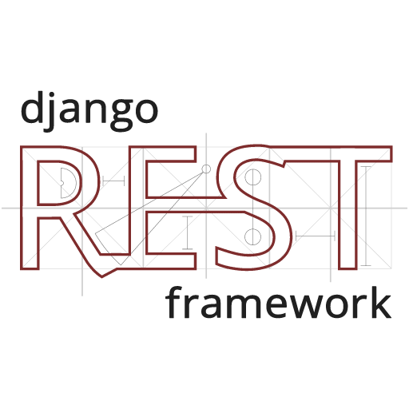
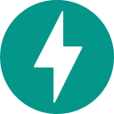
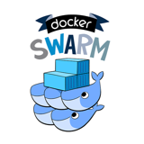
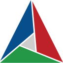
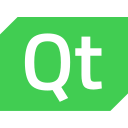

  

## 💼 **Backend Developer**  
**Kiarash Bashokian**  
Passionate Backend Developer with experience in designing and implementing robust backend systems using **Monolithic**, **Hybrid**, and modern **Microservices Architectures**. Adept at building both **MPA + SSR** and **SPA + API** solutions, with a focus on scalability, security, and performance.

### 🔧 **Key Skills & Technologies**  
- **Programming Languages**: Python, Java, PHP, JavaScript, TypeScript, C, C++, Bash, Shell Script
- **Frameworks**: Django, Django REST Framework (DRF), FastAPI, Flask, Spring Boot, Celery, Qt
- **Databases**: PostgreSQL, MySQL, SQLite, Microsoft SQL Server, Oracle Database, MongoDB, Redis, Memcached
- **APIs & Testing**: REST APIs, WebSocket, Postman, pytest, unittest
- **AI & LLM**: RAG / GraphRAG workflows, vector databases, LLM integration (OpenAI, Claude)
- **DevOps & Cloud**: Docker, Docker Swarm, Kubernetes, NGINX, Apache, Git, GitHub Actions, Prometheus, Linux (Ubuntu, Arch, Debian), cPanel, Mail Servers
- **Infrastructure & Virtualization**: VMware, VirtualBox, Linux Server Administration, Network Services
- **Frontend**: HTML5, CSS3, Tailwind CSS, React.js, WebKit, Bootstrap
- **Other**: Django ORM, CMake, Shell Scripting, Linux Networking, Cisco DNA Center, CCNA, Network+

---

### 🚀 **Experience & Focus Areas**  
- **Backend Systems Design**: Building scalable, secure, and efficient backend solutions using both monolithic and modern microservices patterns.
- **API-First Development**: Expertise in REST API design, documentation (OpenAPI/Swagger), and integration.
- **Database Engineering**: Advanced SQL/NoSQL skills, optimization, and high-availability strategies.
- **DevOps & Automation**: CI/CD with Docker, GitHub Actions; container orchestration with Docker Swarm and Kubernetes; infrastructure automation.
- **Asynchronous Programming**: Using Celery, FastAPI, and Redis for distributed and async tasks.
- **AI Services**: Building AI microservices for document parsing, embeddings, and RAG / GraphRAG pipelines.
- **Systems Programming**: Low-level C/C++ work — custom network transport protocols, kernel development, and system monitoring.
- **Security & Performance**: Secure authentication (OAuth2, JWT), API security, and performance optimization.
- **Continuous Learning**: Always exploring new backend technologies and industry best practices.

---

### 🌟 **Modern Backend Highlights**
- Microservices with Django, FastAPI, Spring Boot, Docker
- Container orchestration (Docker Swarm, Kubernetes)
- AI microservices & RAG / GraphRAG pipelines
- Asynchronous workflows (Celery, Redis)
- Database performance tuning & caching strategies
- Secure, scalable API design
- CI/CD automation & cloud deployment
- Linux server/network administration

---

### 📜 **Professional Experience**
- **Programmer Assistant** — York University, UIT LTS Team *(08/2025 – Present)*: AI microservices, RAG / GraphRAG workflows, CI/CD pipelines, and Moodle plugin modernization.
- **Network Service Assistant** — York University, UIT Network Team *(05/2025 – 08/2025)*: Campus network monitoring tool built on Cisco DNA Center APIs and workflow automation.
- **Web Developer** — Gh Light *(03/2024 – 05/2024)*: Full-stack website delivery covering backend, frontend, database, and SEO.
- **IT Expert** — Arya Heavy Machinery *(11/2023 – 02/2024)*: Servers, firewalls, vCenter, and network infrastructure for 200+ employees.
- **Qt Developer Trainee** — Arad *(09/2022 – 12/2022)*: C++ GUI application development with the Qt framework.

---

### 📌 **Featured Projects**
- [**SocketCast**](https://github.com/Ghosts6/SocketCast) – Reliable-UDP media transport protocol built from scratch in C++ (selective-repeat ARQ, BBR-inspired rate control) with FastAPI, React, and Kubernetes.
- [**KerniX**](https://github.com/Ghosts6/KerniX) – Experimental bare-metal C and Assembly kernel focused on memory management (MMU/paging) and process scheduling.
- [**RiseUp**](https://github.com/Ghosts6/RiseUp) – AI-powered alarm and task reminder system in Java (Spring Boot API, Picocli CLI, JavaFX GUI).
- [**system-metrics**](https://github.com/Ghosts6/system-metrics) – Cross-platform system metrics and log analytics platform (C/C++, Qt, FastAPI, PostgreSQL, Redis).
- [**ai-platform**](https://github.com/Ghosts6/ai-platform) – Full-stack framework for building and managing task-oriented AI agents (Django, React, Celery, RAG).
- [**weather_news**](https://github.com/Ghosts6/weather_news) – Real-time weather and news platform with a Django REST API and React/TypeScript frontend.
- [**client_count**](https://github.com/Ghosts6/client_count) – FastAPI network monitoring tool for wireless APs and client counts via Cisco DNA Center APIs.

---

### 🌐 **Connect**  
Explore my open-source contributions on my [GitHub profile](https://github.com/Ghosts6), or visit my [personal website](https://www.kiarashbashokian.com) to learn more about my work and current projects.  
For my full CV: [My Latest Resume (PDF)](https://kiarashbashokian.com/static/MyResume.20f151b4d55d.pdf)

---

# 📊 GitHub Stats:

---

  <section>
    <h3>Backend Development</h3>
    

      
      
      
      
      
      
      
      
      
    

  </section>

  <section>
    <h3>Databases</h3>
    

      
      
      
      
      
      
      
      
    

  </section>

  <section>
    <h3>Frontend (Integration)</h3>
    

      
      
      
      
      
      
      
    

  </section>

  <section>
    <h3>DevOps & Infrastructure</h3>
    

      
      
      
      
      
      
      
      
      
    

  </section>

  <section>
    <h3>Tools & Technologies</h3>
    

      
      
      
      
      
      
      
      
      
    

  </section>

---

## 📱 **Social**

  
  
  
  
  
  

---

## 📬 **Contact Me**  
You can reach me via:

- **GitHub**: [github.com/Ghosts6](https://github.com/Ghosts6) – Explore my projects.
- **Website**: [kiarashbashokian.com](https://www.kiarashbashokian.com) – My personal portfolio.
- **LinkedIn**: [linkedin.com/in/kiarashbashokian](https://linkedin.com/in/kiarashbashokian)
- **Email**: [kiarash@kiarashbashokian.com](mailto:kiarash@kiarashbashokian.com)

---

<picture>
  <source media="(prefers-color-scheme: dark)" srcset="https://raw.githubusercontent.com/Ghosts6/Ghosts6/output/github-contribution-grid-snake-dark.svg">
  <source media="(prefers-color-scheme: light)" srcset="https://raw.githubusercontent.com/Ghosts6/Ghosts6/output/github-contribution-grid-snake.svg">
  
</picture>

_generated with [Platane/snk](https://github.com/Platane/snk)_

---

